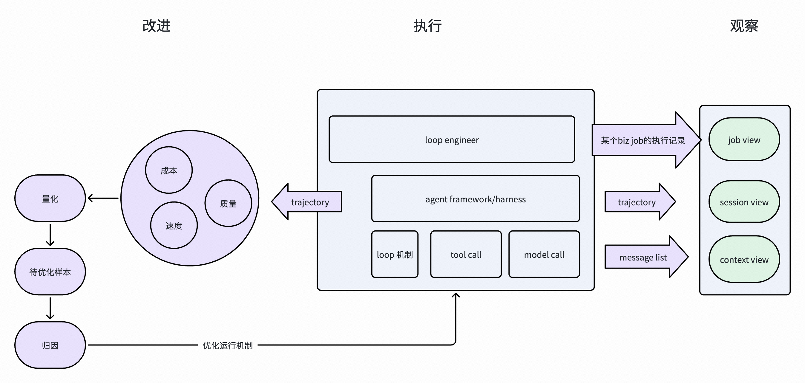

# trajectory_harness 设计

## 1. 定位

trajectory_harness 把 agent 的决策与行动序列变成可反复分析的质量资产，核心是对轨迹问题
持续做三件事：

1. **量化**：记录效果、成本、调用、耗时和失败等可比较信号；
2. **细化**：把模糊的“轨迹不好”下钻到具体 trajectory、step、行为模式和证据；
3. **积累**：持久化 Dataset、Run 和趋势，并把反复出现的问题、证据模式和分析方法沉淀为
   可复用的质量资产。

`measure / detect / verify` 是支撑这三个目标的处理手段，不是 trajectory_harness 的项目定位。
Harness 主要回答“哪里有问题、证据是什么、程度和趋势如何”；从问题走到“下一步改哪里”，
需要上层 quality plugin 的 trajectory skill 结合被测项目的 prompt、tool、loop、compact 和编排上下文，再设计
可对照的改进实验。

### 总纲：执行、观察、改进

围绕 Agent 执行建立两条相互关联的路径：一条把业务经过、loop 行为与请求上下文呈现给人，
便于观察与监督；另一条从 Good / Fast / Cheap（质量或效果、速度、成本）评价表现，选择待优化
样本，证据归因后改进，并用新执行验证。低分 bad case 是筛选手段之一，高成本成功、偶发失败、
退化趋势和人在视图中发现的异常也可以成为入口；量化信号本身不证明根因。



- **执行**：业务编排与 Agent framework/harness 组织 loop、model call 和 tool call，产生执行事实。
- **观察**：三种 View 将业务经过、执行轨迹、请求上下文呈现给人，支持观察与监督。
- **改进**：从质量、速度、成本评价表现，筛选待优化样本，证据归因后优化运行机制。

每次优化都产生新的执行轨迹，通过同任务、同评价标准的对照复评验证效果；新一轮评价仍须保留
完成率与证据覆盖，不能把提前失败带来的耗时或成本下降解释为改善。

三种 View 主要工作在渲染与呈现层，让流程对人可见、可理解、可追查；`SessionView / JobView`
是供渲染使用的读模型，TUI / Web 是展示界面。评分可以下钻到视图中的证据，人也可以发现尚未
被评估器覆盖的问题。观察无需先评分，评分无需先渲染，两条路径通过事实身份与证据引用关联。
自动评分结果不替代人的业务监督，人的观察也不自动成为已验证的结论。

| 层次 | 职责 |
|---|---|
| Trajectory skill | 整体方法指导：观察、评价、选题、归因、优化与验证，并路由到已有专题方法。 |
| Trajectory Harness | 工程支撑：标准化、固定 Dataset、重复评估、独立结果与证据引用、视图导出和比较报告。 |
| CCR 等消费项目 | 实践：真实 loop 数据、领域判据、适配器，以及可复现的样本、改动与复评结果。 |

这里的 Trajectory Harness 是质量分析 SDK；Agent framework/harness 是被观察的执行框架。
二者职责不同。项目验证出可复用的机制后沉淀到 SDK，可复用的判断方法沉淀到 skill；领域
工具、阶段和评分标准仍由项目持有。SDK 存在不等于项目已完成采集、评分或优化验证。

| 视角 | 主要问题 | 分析本体 |
|------|----------|----------|
| eval_harness | 最终回答好不好 | response / sample |
| trajectory_harness | 行动过程是否合理、失败和指标如何变化 | trajectory-keyed Worksheet |
| trace_harness | 物理链路哪层先反常 | span 投影出的 Node |

稳定处理链路是不断把不同来源的信息对齐到同一条 Trajectory，而不是在互不相干的模型之间搬运数据：

```text
RecordingSource
  -> Recording                         原始 record / trace，中间产物
  -> TrajectoryLoader / Adapter
  -> ATIF v1.8 Trajectory               业界标准的过程事实
       + TrajectoryAnnotation          人工、外部系统或模型提供的监督信息
  -> Trajectory Unit                   以 Case + Trajectory 为数据来源
  -> TrajectoryDataset                 可复用、版本化的 Unit facts
  -> Measurements                       从 Trajectory 确定性派生的数据
  -> Trajectory + Measurements
       -> Detector / Verifier / Policy
  -> TrajectoryAnalysisRun / Worksheet
       + DetectionResult -> Finding    保留 detect 执行状态并追加发现
       + VerificationResult            向同行追加判据验证结果
       + MeasurementResult             向同行追加派生事实
       + target / category dimensions  标识评估对象与观察面
       + aggregate Metrics             对 Worksheet 分组和聚合
  -> internal JSON / verdict.json / report.html
```

ATIF `Trajectory` 是 trajectory_harness 的 Observation，也是贯穿全链路的主记录；Harness 要求
ATIF v1.8 可选的 `trajectory_id` 在进入 Dataset 时存在，并将其作为 Unit key 和 Worksheet 行键。
agent name、version、model 与 tool definitions 使用 ATIF 标准字段；Recording URI 以及
instruction/skill、tool contract、loop、orchestration 等尚无标准字段的 provenance，只能进入
ATIF namespaced `extra`。真实值由 Loader 或项目 wrapper 填写，Harness 不从 Dataset 或 Verifier
version 推断，也不为它们另建一套 Trajectory schema。
Dataset Builder 负责把 Case seed、人工 label、reference 和
LLM 生成的监督信息对齐到 Unit，形成可反复分析的 TrajectoryDataset。每组实际选择的 Detector、
Verifier、Measurer 与可选 Policy 分别产生自己的 AnalysisRun / Worksheet；报告只对 Worksheet 做筛选、分组、聚合和展示，不重新
读取 Source，也不重新解释原始 trace。

这里的“大表”是逻辑模型，不要求 JSON 把整条 Trajectory 在每个结果中重复一遍。Dataset 保存
Trajectory 与 Annotation seed，Run 保存本次 Finding、Verification 与 Measurement，再通过 `trajectory_id`
无损恢复 Worksheet；同一 Dataset 可以对应多张不同侧重点或不同规则版本的 Worksheet。

这里评估的对象是一次面向目标的 agent/workflow 执行。一个 Trajectory 可以只包含一个 agent
loop，也可以包含由多个 agent loop 和确定性操作共同组成的 pipeline。每个 agent loop 的行为通常由
三部分共同决定：

1. system prompt：目标、约束和行为指令；
2. tool set：可用能力、描述、参数与返回契约；
3. loop mechanism：上下文压缩、停止条件、轮次或时间预算等运行策略。

Trajectory 是这些 loop 配置及其编排共同作用后的运行证据，不要求 Loader 反推出某个行为究竟由哪一段
配置单独造成。本次 Dataset 选择的 ATIF 文档就是一行 Trajectory；多个 loop 按 ATIF v1.8 使用
`subagent_trajectories` 与 `SubagentTrajectoryRef` 表达。OTel span parent 等来源拓扑可以保存在
namespaced `extra` 供专门分析使用，但不成为另一套通用 Step tree。具体业务可以选择某段 step 或
subagent trajectory 进行评估，无需让通用 Harness 理解 Review 1、Review 2 等领域阶段。

Trajectory 是规范化执行事实，Measurements 是从 Trajectory 确定性派生的数据；二者共同作为
Detector 与 Verifier 的输入。Detector 负责数据挖掘和发现并沉淀 Finding，Verifier 负责针对明确
判据验证并产生 verdict 或 score。两者都可以分析成本或效果，也都可以由硬规则或软规则实现；
`category=cost|effect` 与 `rule_type=hard|soft` 是两个正交维度。Measurer 只是派生 Measurements 的
实现机制，不是与 Detector、Verifier 并列的判断角色。单个行为模式通常只是 Finding；除非存在明确契约，不能直接把它定性成
Failure，也不能由 Harness 单独推导出应修改 prompt、tool、loop mechanism 还是 pipeline 编排。

### 事实来源与视图投影

Trajectory 是执行轨迹这一概念；ATIF 是本 Harness 采用的业界轨迹格式标准，并非唯一标准。
`ATIF Trajectory` 保存标准化执行事实，作为持久化与评估输入。`SessionView` 是 Agent Ledger
定义的观测读模型，主要服务渲染与人的监督；TUI / Web 是展示层。三者不是同一种格式的不同名字。

```text
一次模型调用的 message list -----------------------> Context View
一次 loop execution -> ATIF Trajectory ------------> SessionView -> TUI / Web
                            └-> 评估器 -> 独立评分结果
一个业务目标的执行经过（一个或多个 loop + 确定性操作） -> JobView
```

| 视角 | 组织对象 | 主要回答 |
|---|---|---|
| Context View | 一次模型调用实际收到的消息列表及工具定义 | 当时给了什么上下文，如何组织，有什么缺口？ |
| SessionView | 一个 Agent Session 中的输入、调用与执行关系 | Agent 如何决策、行动、接收反馈并继续执行？ |
| JobView | 一个业务目标及参与它的调用、loop、确定性操作与结果 | 业务经过哪些工作、交接与交付，目标是否完成？ |

Context View 按 message 的真实顺序、role 和内部章节组织；消息列表本身不等于完整请求，工具定义
等可能位于消息之外。缺少原始请求时必须标明重建或缺失，不能从输出补造 prompt。

这里的 loop 是一次实际 execution，不是 loop 算法或进程。以 CCR 为例，可把 R1 / R2 的每次
loop execution 转为一条 ATIF Trajectory；这属于项目选择的评估粒度，不是 ATIF 强制一条文档
只能包含一个 loop。一个原生 Session 可以承载多次 loop，所以多条 Trajectory 可以共享
`session_id`，并投影进同一个 SessionView。`trajectory_id` 标识文档，不能替代 Session 身份。
内嵌子轨迹的 Session 继承遵循 ATIF 契约，不从业务 Unit 或运行顺序猜测。

业务经过可能跨 Session，也可能只使用共享 loop 的部分调用；一个 loop 也可能服务多个业务目标。
JobView 通过业务身份与调用引用组织这些工作，不通过拼接整份 SessionView 推断归属，也不自动把
所有 R1 / R2 当作父子 agent。SessionView 还可从 Trace 或原生录制直接生成，不要求所有来源先转为
ATIF；投影视图不保证能无损反向重建 Trajectory。

标准化与评分分离：同一固定 Trajectory 可以按多个明确维度反复评估，结果记录规则版本、维度、
分数或 verdict，以及回到 trajectory / step 的证据引用。低分按项目阈值筛为 bad case，再诊断原因、
实施优化，用相同任务与相同评分规则评估新执行产生的轨迹。缺失证据与不适用不能当作零分或通过；
视图渲染不能改写轨迹或隐式重新评分。具体视图契约见 [Session observations](session-view.md)。

### 1.1 Source 与 Loader 边界

`RecordingSource` 统一“从哪里找轨迹原料”：`select(RecordingQuery)` 返回只含身份、URI、时间和
低成本属性的 `RecordingRef`，`fetch(ref)` 才读取完整原始文本。公共 Query 只提供时间、精确属性
和数量上限；仓库、租户等领域过滤可由具体 Source 扩展。

Source 不理解 ATIF、OTLP 等格式，不构造 `Trajectory`，也不拥有人工标签。原生 ATIF 由
`ATIFJsonLoader` 校验；OTLP、session 等由对应 Adapter 转为同一 ATIF 契约。forge comment 等监督
信号属于 `TrajectoryAnnotation`，由业务 Dataset builder
通过 `trajectory_id` 与主记录连接。一个 Annotation 可以关联一条或多条 Trajectory，也可以暂时没有
匹配结果，从而保留“监督信息已存在，但原始记录拉取或解析失败”的事实。Loader 同时提供文件 `load`
与内存文本 `loads`，因此远端 API、CLI 导出或本地 session Source 不需要先创建临时文件。

### 1.2 Tool set 的两个评估层级

Tool 不能只按“调用成功或失败”评估，还要区分单个工具契约和整个工具集：

1. **单工具契约质量**：tool name 是否准确表达能力，description 是否帮助模型判断适用边界，
   argument schema 是否清晰且约束恰当，result 是否便于模型继续决策。轨迹上的无效参数、schema
   错误、换参数重试和调用后立即纠正，是模型能否稳定生成合理调用的证据。
2. **工具集覆盖与效率**：tool portfolio 是否覆盖该行业或任务中反复出现的高价值动作，工具之间
   是否存在明显空白、重叠或选择歧义。`read / write / edit / bash` 等最小通用工具集可能足以完成
   任务，却不一定高效；模型反复借助 shell 安装依赖、拼接临时命令或绕行多步完成固定动作，会表现为
   轨迹变长，是缺少专用工具或批量能力的候选 Finding。

第二类判断需要任务和行业上下文。通用 Harness 可以测量无效参数率、重试、连续调用、通用执行器
占比和轨迹长度，但不内建“某个行业必须有哪些工具”的清单；期望的 tool portfolio 及其契约由 domain
Verifier 或 Dataset 提供。Detector 也可以结合这些领域输入发现工具集结构问题。一个通用工具被频繁使用
不自动说明工具集有问题，只有与 case 类型、
替代路径、耗时和结果质量结合后，才能形成 warning 或 fail verdict。

## 2. 轨迹事实

### 2.1 Trajectory 与 Step

`Trajectory` 与 `Step` 直接使用第三方 `atif` v1.8 Pydantic models。Step 按标准表达
`system / user / agent` 消息、reasoning、tool calls、observations、LLM metrics 与 copied context；
Harness 不复制这些字段，也不定义平行格式。Detector 与 Verifier 直接读取 ATIF；只有 Loader / Adapter
读取 OTLP、session 或框架私有字段。顺序使用标准 `step_id`，多 agent 使用标准 subagent 结构。

轨迹不是 trace tree 的别名。trace_harness 保留物理遥测事实并分析错误传播与拓扑；
trajectory_harness 只保留 agent 决策和评估需要的语义步骤。

### ATIF v1.8 输入与视图契约

Harness 仅接受并输出 `ATIF-v1.8`，内嵌子轨迹也必须声明这一版本。Loader、Dataset 与
SessionView 入口拒绝其它版本，不升级旧文档，也不将格式不符解释为空轨迹。Python 使用第三方
`atif>=1.8,<1.9` 的模型校验内容，格式定义以 Harbor ATIF RFC 为准。

`Step.message` 与 `ObservationResult.content` 保留字符串或 text/image/audio ContentPart 数组。
音频的 `media_type / path / duration_sec` 与图像引用原样保留（MIME 别名由上游模型标准化）；
Loader 收到的 source URI 保留在 recording provenance 中，为相对媒体路径提供来源上下文。
Harness 不读取媒体文件、不自动转写，也不从路径长度推算媒体大小或 token。工具结果字节指标
度量的是序列化 observation 的 UTF-8 JSON 大小，而非引用文件的大小。缺少音频语义能力的业务
Verifier 应返回 `status=not_applicable` 并说明原因，不能把未评估当作通过或零分。

Dataset 一行仍对应一个顶层轨迹文档；内嵌子轨迹不自动变成额外分析行。SessionView 递归投影
内嵌子轨迹：省略 session_id 的子轨迹继承父级 run identity，显式声明其它 session_id 的子轨迹
进入对应视图；根节点缺少 session_id 时保持未归属。节点 ID 由祖先路径限定，避免不同父级下
同名子轨迹冲突。视图保留原始 trajectory/session ID、父子关系、source、final_metrics、notes
与 continuation 引用；外部 trajectory_path 保留为引用，不隐式加载文件。视图展开不代表父子
轨迹步骤存在全局时间顺序，也不重复计算父级聚合 usage。

### 2.2 Failure 与 ExecutionResult

轨迹本身不保证成功。ATIF 尚未规定统一失败 taxonomy；来源提供这类事实时，Adapter 把它放入
`extra.quality_harness`，Harness 可以读取为：

```python
Failure(
    kind="tool",
    phase="prepare",
    error_type="dependency_missing",
    code="ENOENT",
    message="executable not found",
)
```

常见 LLM 失败由 `llm_failure(phase, error_type)` 统一构造，timeout 可用
`llm_timeout(phase)` 缩窄到已观测的请求进度边界。公共 error type 包括 `timeout /
rate_limit / client_error / server_error / network_error / invalid_response / unknown`。Harness
只拥有稳定词汇，不猜测 provider 错误文本；原始错误到 Failure 的分类仍由 Loader 完成。

LLM timeout phase 使用客户端可观测的边界，不反推服务端内部根因：

| phase | 含义 |
|-------|------|
| `routing` | 路由、端点选择或多次 attempt 共享的总预算耗尽 |
| `connection_pool` | 未在时限内取得客户端连接池连接 |
| `connect` | DNS / TCP / TLS 等建连过程超时 |
| `request_write` | 请求 header/body 尚未写完 |
| `first_chunk` | 流式请求写完后，首个非空响应 chunk 未在时限内到达 |
| `inter_chunk` | 已收到输出后，下一个响应 chunk 未在时限内到达 |
| `request` | 整体 request/route deadline 耗尽，而来源无法提供更细进度 |

`first_chunk` 对齐 OpenTelemetry 客户端的
[`gen_ai.client.operation.time_to_first_chunk`](https://github.com/open-telemetry/semantic-conventions/blob/main/docs/gen-ai/gen-ai-metrics.md)；
HTTP 传输层的 pool/connect/write/read 划分与
[HTTPX timeout](https://www.python-httpx.org/advanced/timeouts/) 一致。已经开始流式输出后的“无进展”
对应 [inter-chunk latency（ICL）](https://docs.nvidia.com/aiperf/reference/ai-perf-metrics-reference)
的观测边界以及 Envoy 的
[`per_try_idle_timeout`](https://www.envoyproxy.io/docs/envoy/latest/api-v3/config/route/v3/route_components.proto.html)
语义。

TTFT、ITL/TPOT 和 end-to-end latency 是 Measurement，不是天然的 Failure 类型。TTFT 包含网络、
排队、prefill 和首 token 生成；ITL/TPOT 是输出 token 间延迟的聚合值。只有调用方对这些
边界实际执行 deadline 时，才产生 `first_chunk` 或 `inter_chunk` timeout Failure；“TPOT 偏高”
本身应由 Measurer 输出 Measurement；只有识别出稳定行为模式后才形成 Detector Finding。vLLM
服务端进一步暴露 queue、prefill 和 decode 时间，
这些数据可作为 Step attributes 帮助归因，但客户端 Loader 不应凭 TTFT 猜测其中哪一段超时。

分类维度保持正交：

- `kind`：失败操作的类别，如 `llm / tool / agent / workflow`。
- `phase`：失败发生的阶段，如 `routing / request / resolve / prepare / execute`。
- `error_type`：可跨操作复用的低基数类型，如 `timeout / rate_limit /
  dependency_missing / permission_denied / unknown`。

完整 key（如 `llm.request.timeout`）只在查询和展示时派生。Provider 状态码、异常类名及原始
描述分别保留在 `code` 和 `message`，不膨胀稳定分类。

具体操作失败放在 `Step.failure`；整条轨迹的权威结果放在 `ExecutionResult`。某个 Step 失败但
最终 `outcome=completed` 表示流程已恢复；`ExecutionResult.failure` 只表达导致最终未完成的
主要失败。主动取消可以只有 `outcome=canceled`，不必伪装为 Failure。

## 3. 评估

### 3.1 Detector 与 Verifier

Detector 和 Verifier 按职责而不是实现技术区分：Detector 做开放式或目标明确的数据挖掘与模式发现，
输出带证据的 Finding；Verifier 针对显式判据做验证，输出 verdict 和/或 score。确定性代码、
reference match、LLM judge 或 agent 都可以实现其中任一角色。使用模型不会自动把 Detector 变成
Verifier，使用代码也不会自动意味着 Verifier。

`DetectorSpec` 与 `VerifierSpec` 都声明稳定 id、说明、owner、`common/domain` 类型，以及两个正交维度：

- `category=cost|effect`：分析成本还是效果；
- `rule_type=hard|soft`：使用可确定执行的硬规则，还是带判断弹性的软规则。

因此 Detector 可以发现成本浪费或效果问题，Verifier 也可以验证成本预算或效果契约。Runner 根据每个
Trajectory Unit 的 target 选择适用组件，并把 target/category 写入 Worksheet 结果；规则类型进入组件
catalog 和持久化 spec。

首批通用 Verifier：

- `execution_success`
- `tool_success`
- `MeasurementThresholdVerifier`：由业务显式提供 measurement、阈值、方向和稳定 verifier id，
  可复用同一个硬规则实现验证成本预算或效果下限。

首批通用 Detector：

- `repeated_tool_call`
- `retry_loop`
- `post_compact_refetch`
- `unchanged_tool_retry`
- `oversized_tool_observation`
- `short_decision_churn`
- `context_bloat_without_compact`
- `cache_retention_bloat`

其中 `repeated_tool_call` 输出诊断 Finding，提示检查缓存、复用或批量参数的机会；重复调用
本身不等于错误。`retry_loop` 保留最终成功可能掩盖的失败重试，`post_compact_refetch` 只判断
compact 前后完全相同的工具调用；外部资源是否必须刷新仍是待验证假设。
`unchanged_tool_retry` 进一步定位失败后工具参数没有变化的重试；`oversized_tool_observation`
标记超过 64 KiB 的单次工具结果；`short_decision_churn` 标记至少三次有 token 证据且其中 80%
低于 500 output token 的短决策密集现象。后二者只表示成本调查入口，不证明调用或输出没有价值。
`context_bloat_without_compact` 结合 input 绝对值与增长倍数寻找未压缩的长上下文；
`cache_retention_bloat` 只有在高 cache hit、绝对 context 较大且仍持续增长同时出现时才产出 Finding，
避免把高 cache hit 本身误判为浪费。目标不是极高 cache，而是与单位成本和效果相匹配的合理 cache。

文件覆盖率、搜索范围、业务提交是否完成等规则仍由业务包提供；通用 Harness 只负责执行和
聚合，不理解业务工具语义。

### 3.2 围绕 Agent Loop 积累 Finding

trajectory_harness 持续沉淀可跨业务复用的 Detector，其 Finding 可以帮助检查 agent loop 的
三个组成面：

| 观察面 | 可沉淀的通用 Finding | 业务 Verifier 负责的判断 |
|--------|------------------------|--------------------------|
| system prompt | 目标偏离、指令重试、过早结束、输出格式反复自我修正 | 领域指令和结果契约是否真正被违反 |
| tool set | 工具执行失败、无效参数、换参重试、连续重复调用、通用执行器绕行 | 领域工具集是否缺失、重叠或不符合任务契约 |
| loop mechanism | 预算耗尽、timeout、压缩压力、停止不收敛、过早结束 | 具体轮次、时间、压缩和停止策略是否合理 |

这个对应是多对多的诊断索引，不是根因归属。例如连续重复调用同一 tool 是 Finding；它可能暗示
工具缺少批量参数、prompt 未要求复用结果，或 loop 没有合适的停止机制，这些候选解释记录为
`hypotheses`。Detector 只输出可复现的现象、证据和假设，根因与改动方向由上层 quality plugin 的 trajectory skill 结合
项目上下文、反例和对照实验确认。trajectory skill 负责驱动 Harness 取得数据、结合业务判断影响范围与
owner，并推动优化落到使用方式、Agent、接入、平台基础设施、知识库或组织机制；这些归因不进入通用
Detector。

Detector 表达的是发现职责，不限定实现为固定规则。它可以是确定性模式匹配，也可以由 LLM 或
agent 对轨迹做开放式检查，用于发现尚未被明确判据覆盖的问题。这类结果仍然只是带证据的
Finding，不因为使用了模型就变成 Verification 或 Verdict；反复出现且可稳定复现的模式，再沉淀为可复用
Detector。

新的通用 Detector 应在 `detectors/` 中按一种稳定 Finding 一个实现沉淀；依赖行业工具清单、
业务阶段或特定结果契约的判断可以进入 domain Detector 或 Verifier，取决于产物是发现还是判据结论。
pipeline 可以包含多个 loop，跨 loop 的
编排与协作 Finding 同样由 domain Detector 先行沉淀，出现稳定跨业务模式后再上收为通用实现。

### 3.3 DetectionResult 与 VerificationResult

一个 Detector 对一条轨迹返回一个 `DetectionResult`：

- `status`：`analyzed / not_applicable / error`。
- `findings`：零到多个诊断发现；每个 Finding 包含稳定 `code`、`severity`、摘要、
  `step_ids` 证据及可能原因 `hypotheses`。
- `explanation`：Detector 的适用性或执行说明。

一个 Verifier 对一条轨迹返回一个 `VerificationResult`：

- `status`：`verified / not_applicable / error`。
- `verdict`：`pass / fail / warning`。
- `score`：可选的归一化分数。
- `explanation / step_ids`：可读解释与证据锚点。

`not_applicable` 不按 0 分处理；Verifier 异常使用 `status=error`，属于评估执行健康，不是
轨迹质量。Harness 不默认加权不同 Verifier 的 score；如业务需要准入门槛或综合分，应显式
提供 Policy。

Failure、Detector 发现与 Verifier 判定是三条独立轴：`Step.failure / ExecutionResult.failure`
只记录运行时已经发生的失败事实；Detector 发现的行为模式写入 `DetectionResult.findings`，可能原因只是
Hypothesis，不是已确认 Issue。存在改进可能但尚不能判错时使用 `verdict=warning`；业务契约明确
认为该行为不合格时使用 `verdict=fail`。这里不使用 `verdict=error`，因为 `status=error` 专门表示
Verifier 自身执行异常。报告分别展示 Failure 与 Verifier 结果，不能把 warning/fail 反写成
轨迹 Failure。

`Finding` 是 Detector 对证据作出解释后识别的具体问题模式，不是可任意聚合的原始数值。
它使用稳定 `code` 表示模式、`step_ids` 指向证据，并用 `hypotheses` 保存尚未确认的可能原因。token、
调用次数、时长等能直接计数或求和的观测必须进入 Measurement；如果一个 Finding 只是在换名字包装
原始事实，就不应作为 Finding。

Failure 在分析前已经由 Loader 确定，Verifier 不修改它。TrajectoryAnalysisRun 通过 Worksheet
行键连接 Failure、Trajectory 和 Dataset，既可按 target 聚合 `llm.request.timeout` 比例，也可在报告中
回看受影响的具体 trajectory/case。诸如“长上下文更容易 timeout，可能暴露 inference 能力不足”属于
基于 Failure 与 case 特征的关联和归因假设，不属于 Failure 本身。

### 3.4 Measurements 与 Measurer

Measurement 是与 Trajectory 密切关联的派生数据：它可以是轨迹没有直接写出的 token、耗时、调用量，
只要能够从轨迹事实确定性推算，就仍属于 Measurement。Measurer 是产生这类数据的实现机制，只观察
事实，不判断质量。`MeasurerSpec` 声明稳定 `measurer_id`、category 及其可输出的
`MeasurementSpec`；`MeasurementResult` 使用 `measured / not_applicable / error` 表达测量执行状态，
并携带 Measurement、解释及证据 step。它不包含 verdict、score 或 Finding。Detector 和 Verifier
消费 Trajectory 与这些 Measurement，但分别只输出 Finding 或 VerificationResult，不复制派生数据。

通用 Measurer 分别观察模型、工具与上下文使用：

- `ModelUsageMeasurer`：模型调用、input/output/cache token、单次 input/output 分布、低于 500
  output token 的调用数与使用量覆盖率；
- `ToolUsageMeasurer`：执行次数、Failure、耗时、result bytes 总量/均值/峰值、result 覆盖率与已观测并发；
- `ContextUsageMeasurer`：input token 首尾/峰值/增长倍数、compact 次数及 compact 边界前后的 input delta；
- `RetryUsageMeasurer`：失败工具调用、同工具重试覆盖、参数是否变化及是否恢复。

这些值不判断一次读取、压缩或调用是否必要；命名和类型共同表达边界。

通用 Harness 只沉淀跨业务稳定的 Measurement、Detector、Verifier 和流程。若“产出”是有效 finding、
修改文件、生成报表或业务对象，或者任务复杂度、工具结果利用率需要领域语义，trajectory skill 应推动
消费项目基于公共协议实现自己的 Measurer / Detector / Verifier 子类，并由项目 runner 选择；业务字段、
阈值、Rubric 与 owner 不反向进入通用 Harness。

### 3.5 成本与效果联合解释

模型调用次数、input/output/cache token、耗时和工具调用次数都是 Measurement，不天然代表好坏。
相同成本可能用于完成更难的任务，也可能来自重复读取、失败重试或上下文膨胀；因此这些原始量默认使用
`direction=neutral`。Detector 可以发现重复调用、失败重试、上下文增长等成本或效果模式，Verifier
可以检查显式预算或效果契约，但两者都不能只因为 token 更多就判定轨迹更差。

成本优化必须和效果放在同一 Dataset/Cohort 中比较。以 CCR 为例，通用 Harness 负责记录每条 Review
轨迹的 token、模型调用、完成状态和 Finding；CCR 的 domain Dataset、Detector / Verifier 再把这些事实与
Review 1/Review 2、finding 人工标签、missed finding 等监督信号对齐，比较有效 finding rate、wrong
rate、completion/timeout 与单位有效 finding 成本。有限时间或 token 预算下，减少非必要读取、重复
调用和无效重试也可能提高 completion，从而同时改善成本与效果；这种结论必须来自同 workload 的对照，
不能由单条轨迹的低 token 值直接推出。

`ModelUsageMeasurer` 只输出事实与覆盖率，不内建价格表。货币成本依赖 provider、模型、时间、缓存
计费和长上下文阶梯价，应由带 pricing provenance 的消费侧 Measurement 逐调用计算后再聚合，未知
价格保持 unknown，不能静默当作零成本。

报告可以由业务通过 `ParetoSpec` 显式选择一条 effect Metric 与一条 cost Metric，展示 completion、
duration p95 和支配关系。Harness 不从 category 或 direction 自动猜测业务 effect；存在多个 target
或 verifier 时，选择器必须把维度限定到唯一 Metric。

## 4. Trajectory Dataset 与 Worksheet

`TrajectoryDataset` 是可复用、版本化的 Unit facts 集合；其中 Trajectory 是 Observation，Case 与
Trajectory 是 Unit 的数据来源，`trajectory_id` 是稳定 Unit key。Dataset 先固定 Unit 和已有监督
信息；每个 AnalysisRun 再以相同 grain 建立 Worksheet，并填充本次结果列：

```text
Trajectory Unit
├── case                        input / expected behavior / dimensions
├── observation: trajectory     ordered steps / execution result / source identity
└── annotations[]               human / external / LLM-provided supervision

AnalysisRun Worksheet row
├── unit                         dataset seed by trajectory_id
├── detections[]                detector findings
├── verifications[]             verifier verdict and/or score
└── measurements[]              token / latency / calls / resource facts
```

每条 `Trajectory` 通过一等 `recording_id` 保留它从哪份 Recording 投影而来，`source` 保留
URI/path；同一 Recording 解析出的多条轨迹共享 recording id。`TrajectoryAnnotation` 通过
`trajectory_ids` 把 MR comment label、reference 等监督信息连接到一条或多条主记录。Annotation
也可以暂时没有匹配到 trajectory，以保留“label 已存在，但 Recording 获取或解析失败”这一事实；
它不能因此被静默丢弃。

数据的生产者和数据的语义是两条独立轴。人工和外部系统通常产生 Annotation；LLM 既可以产生待评估
的监督信息，也可以作为 Detector 或 Verifier 的实现。前者仍是 Annotation，Detector 通过 DetectionResult
返回 Finding，Verifier 返回 VerificationResult。Finding、verdict 和 score 不回填 Annotation；Measurer
产生的派生事实也不伪装成 Verification。

`TrajectoryDataset` 固定 `Unit + Annotation` seed。`TrajectoryAnalysisRun` 把本次实际选择的
Detector / Verifier / Measurer / Policy 施加到确定的 Dataset version，记录组件 spec 与配置，
为同一批 Unit 填充 Finding、Verification 和 Measurement 列；DetectionResult 只作为 Detector 的执行信封，
保留状态、错误和零到多个 Finding：

```text
TrajectoryAnalysisRun
├── trajectory_ids[]
├── trajectory_targets[]
├── detections[]           target + category + detector results
├── verifications[]       target + category + verifier results
├── measurements[]         target + category + measurement results
└── metrics[]              dimensions 上的聚合结果
```

`target` 回答“当前行分析谁”，例如 CCR 的 Review 1 / Review 2；`category` 回答“分析成本还是效果”，
取值为 `cost / effect`。DetectorSpec、VerifierSpec 与 MeasurerSpec 声明稳定 category，Runner 从
Trajectory Unit 确定 target。Detector 与 Verifier 另以 `rule_type=hard|soft` 声明规则形态。
target、category 与 rule type 彼此正交，不拥有独立生命周期，也不形成额外结果容器。
报告通过 `group_by(target)`、`group_by(category)` 或两者组合产生比较视图。

Dataset 是可复用事实底座，Worksheet 是某个 AnalysisRun 的填表状态与结果。两者通过
`trajectory_id` 无损连接，但 Verification 和 Measurement 不写回 Dataset。Case、Trajectory 或
Annotation 变化会形成新的 Dataset version；只更换 Detector、Verifier、judge model、成本口径或分析侧重点，
应复用 Dataset 并产生新的 AnalysisRun。run id 表示一次填表过程，趋势横轴使用 `created_at`；
Dataset version、实际组件 spec、target 和 category 共同构成结果可比较性。

Measurement 是单条 trajectory row 上的原始测量；Metric 是对 Worksheet 按 run 或 dimension
聚合后的结果。Metric 可以来自四类事实：

```text
Trajectory / ExecutionResult -> completion rate, duration p95
Failure                      -> llm timeout rate, tool dependency-missing count
VerificationResult             -> verifier pass rate, mean score
MeasurementResult            -> token sum, model-call p95, usage coverage
```

Metric 使用 `name + aggregation + dimensions` 寻址，例如：

```text
execution.duration_ms.p95
failure.rate{impact=execution,kind=llm,phase=request,error_type=timeout}
verification.pass.rate{target=review1,category=effect,verifier_id=execution_success}
measurement.value.sum{target=review1,category=cost,measurer_id=model_usage,measurement=input_tokens}
```

多个 TrajectoryAnalysisRun 上同一地址的 Metric 按 `created_at` 构成趋势序列。报告接口也可直接
接收已经持久化的 Metric，因此生成历史趋势不需要重新读取 Source 或重跑 Verifier。

### 4.1 Dataset 与 Run 模型产物

`TrajectoryHarness` 把 Dataset 和 AnalysisRun 规范化保存到 `runs/<scope>/<run-id>/`。文件拆分
是为了复用和避免重复大体积轨迹，不改变“一行一个 trajectory_id”的 Worksheet grain：

- `dataset.json`：Worksheet 的固定 seed，原样包含合法 ATIF Trajectory，并附带 TrajectoryAnnotation、RecordingQuery
  与构建健康。
- `run.json`：本次 TrajectoryAnalysisRun，DetectionResult/Finding、Verification 与 Measurement 通过 trajectory id 引用 Dataset，
  不重复存轨迹。
- `report.html`：从 Worksheet 纯投影出的 UI-friendly 视图。
- `verdict.json`：跨 Harness 统一出口；Finding 不自动成为 check，无领域 Policy 时为 `skipped`。

生成周报或版本报告时，`TrajectoryReportBuilder` 从 `history_dirs` 只读加载历史。
历史不写入当前 `run.json`，避免每周复制全量旧轨迹导致 O(n²) 存储和来源混淆。
纯重渲染只需 Reporter 和持久化产物，不需要 Source、Loader、Verifier 或 Measurer 实例。

生命周期分为三个可独立使用的阶段，一键门面只做编排：

```text
TrajectoryDatasetBuilder:   select -> fetch -> load -> annotation join -> versioned Dataset
TrajectoryAnalysisRunner: Dataset -> Measurements -> Detectors / Verifiers / Policy -> Worksheet -> Run + Metric
TrajectoryReportBuilder:    Worksheet + external history -> Report IR -> report.html
```

领域只负责 Dataset Builder 的 annotation join、Runner 的 target/插件选择、可选 Verdict Policy，
以及 Reporter 的业务 `Section`。GitHub MR、comment label、Review 1/2 等概念因此留在
CCR，不进入 trajectory_harness；HTML 模板和数据到视图的控制流则只有 Harness 一份。

## 5. 报告

trajectory_harness 拥有轨迹领域报告语义，对外提供 `build_report`、`render_report_html` 和
`write_report_html`，并由 `TrajectoryReportBuilder` 提供持久化产物到 HTML 的纯构建入口。固定章节覆盖：

1. TrajectoryAnalysisRun、Dataset 及 target/category 维度。
2. 执行结果与 Failure 分类。
3. common/domain Detector 目录与 Finding evidence。
4. common/domain Verifier 目录与 Verification evidence。
5. Measurer 目录与 Measurement evidence。
6. 最新 Metric。
7. 多个 Run 的 Metric 趋势。
8. Source/Loader 的 Dataset build health（通过一键 Harness 生成时）。

实现上先投影为 `harness_common.report_kit.Report`，再使用公共 HTML renderer。report_kit 只
理解 Section、Table、Chart 等中立文档块；业务子类可以从持久化模型追加 Section，但不自行维护
HTML 模板。这个“模型产物先落盘、报告可独立重建”的做法与 perf_harness 的 run model/report
分层一致；各 Harness 仍拥有自己的生命周期，不引入跨 Harness 的通用 Engine。

## 6. 外部语义

[ATIF v1.8](https://github.com/harbor-framework/harbor/blob/main/rfcs/0001-trajectory-format.md)
是唯一 Trajectory 数据契约，Python 实现直接依赖第三方 `atif` 包。OTel GenAI semantic conventions
提供 operation、message、metrics 和 `error.type` 等遥测词汇；`OTelJsonLoader` 负责把它们映射到
ATIF 标准字段，无法无损映射的来源事实保留在 namespaced `extra`。Harness 只拥有 Dataset/Run、
Measurements、Detector、Verifier 和报告流程，不拥有另一个 Trajectory IR。

### 扩展命名空间

Harness 扩展统一读写 `extra.quality_harness`，不提供旧命名空间兼容或迁移。
Trajectory 与 Step 的来源、执行和诊断事实均遵循此约定；其它 producer 的 `extra` 内容保持原样。
回归契约见 `sdks/python/trajectory_harness/tests/test_atif_json.py` 与 `test_pipeline.py`。

## Measurement 的 Session / Global 展示

`measurement_views(run, trajectories=dataset.trajectories)` 是纯结果投影，不执行 Source、Loader、Measurer、Detector 或 Verifier。
它返回带 Run ID、Dataset version 与生成时间的轻量 JSON 契约，可由 Web、TUI 或其它消费者通用渲染。
值以 `measurer_id + measurement name` 标识，目录提供标题、描述、单位、方向与聚合方式；注册并执行的新 Measurer
自动进入展示，不需要在 Viewer 中增加指标分支。基础 token、model/tool 次数与累计调用耗时也来自同一套 Measurement。

- Session 根据顶层 Trajectory 的显式 `session_id` 分组，保留可定位 ATIF Step 的证据；同一 Session 的多个 loop 只生成一个展示分组。
- Global 对所选 Run 的顶层测量结果聚合一次，不展开子轨迹重复计数，也不包含 Session 分布或调用证据明细。
  业务侧选择当前 Review 对应的 Run/Worksheet；Harness 不理解 Review、Unit 或 Lane。
- 数值聚合复用 `aggregate_measurements`。`MeasurementSpec.summary_aggregation` 选择已声明的一个聚合；省略时使用
  `aggregations` 的第一项。次数通常先声明 sum，比例和均值遵循自身定义，不能作为总次数相加。
- 每个值保留 measured、missing、error 与 not_applicable 的 Trajectory 覆盖数。部分结果缺失时状态为 partial；
  没有可用值时返回 null，不伪装成零。已测得但未声明可用聚合的值标为 not_aggregated。
  这里的覆盖粒度是 Trajectory；模型 usage 与耗时的调用级覆盖继续由对应 Measurer 的计数表达。
- ModelUsageMeasurer 的 model_duration_ms 和 ToolUsageMeasurer 的 tool_duration_ms 是已记录区间的累计值，
  不等于 wall time。duration_reported_call_count 区分未知耗时和真实零耗时。

`TrajectoryReportBuilder.write/rerender` 自动导出 `measurement-views.json`，并在 HTML 中生成 Session measurements 与
Global measurements 两个通用表。`session-views/index.json` 保存测量视图文件引用；原生 `SessionView` schema 保持不变。
结果文件原子替换，历史读取和重渲染只消费既有 Dataset/Run，不会重新测量。
运行中消费者可以针对新的固定快照重复执行确定性测量；展示只说明该 Run 已观测到的事实，不承诺评审完成或数据完整。

```python
from trajectory_harness import measurement_views

views = measurement_views(artifact.run, trajectories=artifact.dataset.trajectories)
consumer_payload = views.to_dict()
# consumer_payload["global"]["values"]: 单个汇总值，无 Session 分布
# consumer_payload["sessions"]: 按显式 Session 归属的值及证据
```

### Go 的原生 Session 测量入口

`sdks/go/trajectory` 是独立 Go 1.26 module，直接消费 agent-ledger `SessionView` 已记录的
模型和工具调用，不在 SDK 中新建另一套 Trajectory/Step 格式。Python 继续消费 ATIF，重叠
measurement 通过 `conformance/trajectory/session-measurements.json` 共享事实与预期结果。

Go 的 `Runner` 只执行确定性 Measurer，产出目录与逐 Session 结果；`Project` 纯粹生成 schema 1
的 Session / Global 展示投影。默认支持 model usage 与 tool usage，包括工具失败数、状态覆盖、
调用次数、token、累计耗时与耗时覆盖。来源包含 gaps 时已知结果标为 partial。失败比例以全部
已观察工具调用为分母；状态覆盖独立展示，不将未知状态解释为成功。

消费者可在读取视图时显式调用 Runner，并以录制内容指纹和 `Runner.Fingerprint()` 缓存结果。
后者覆盖 Measurer 目录、版本和投影契约；算法变更必须更新版本。重复原生 Session 只计算一次，
冲突快照报错，ToolCall 引用的其它 Session 不展开。Go 此阶段不实现 Detector/Verifier。
